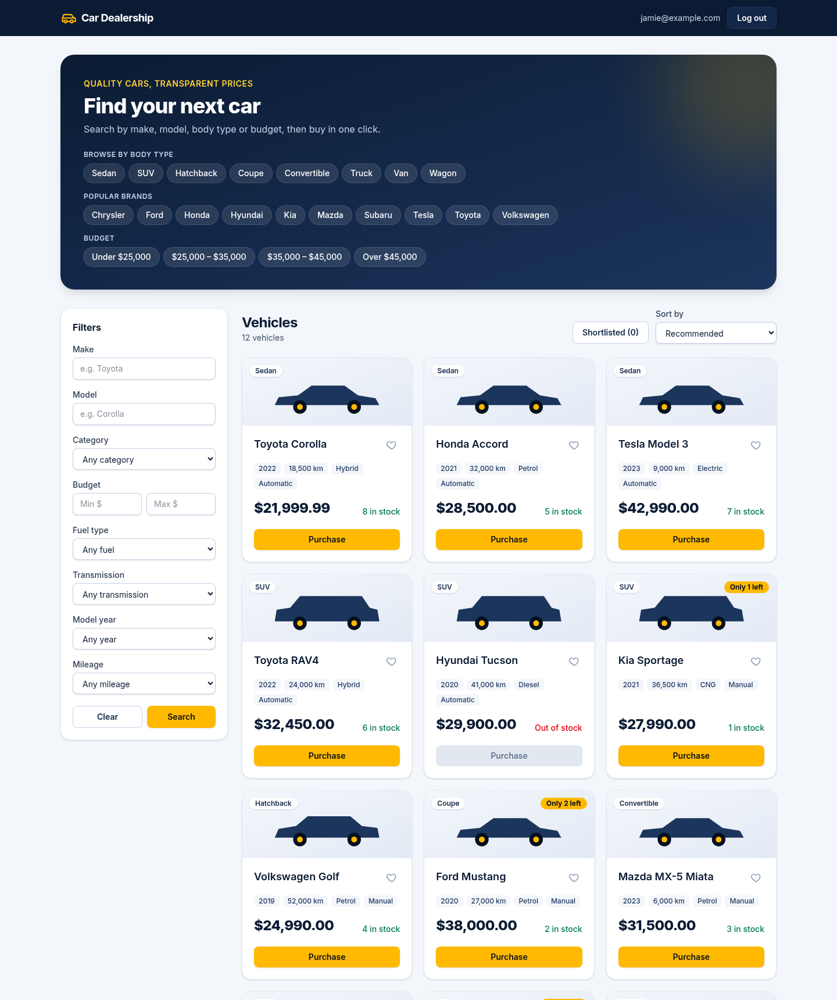
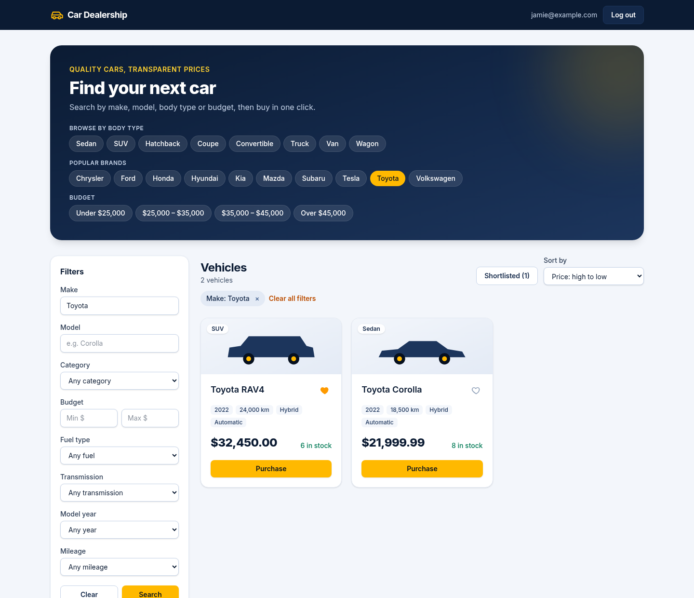
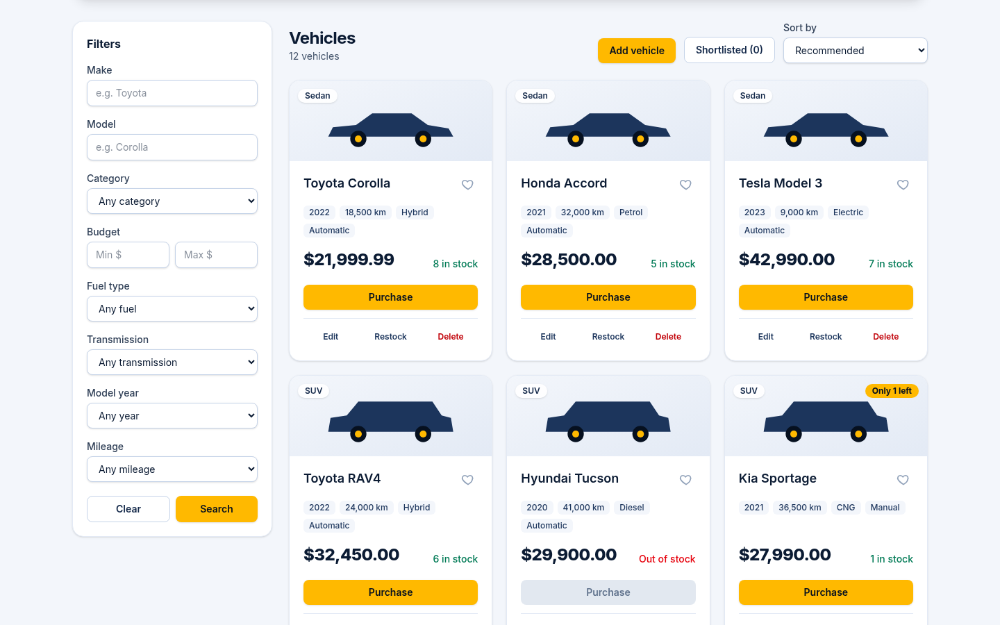
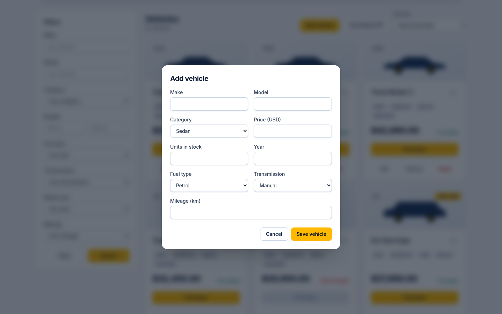
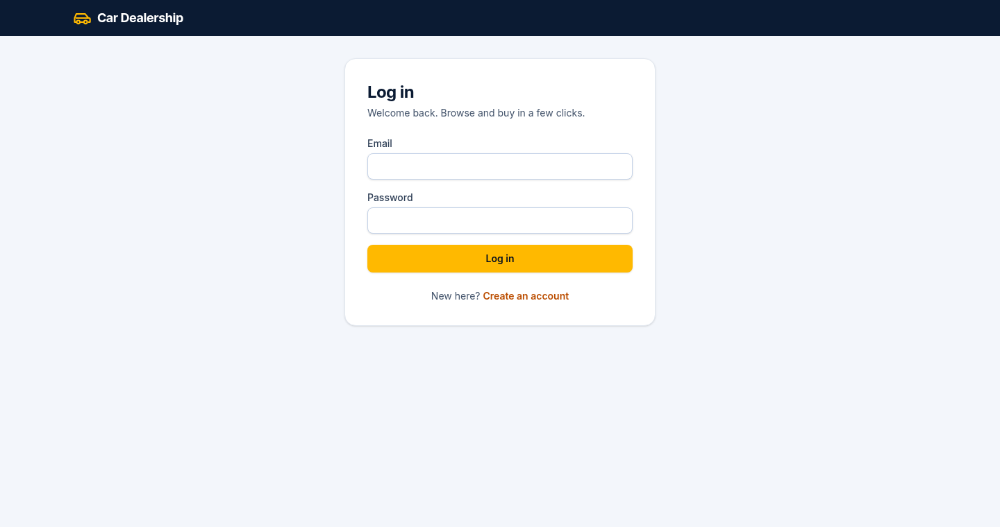
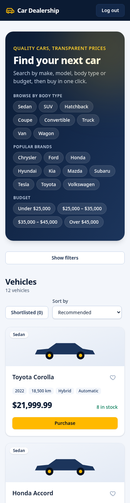

# Car Dealership Inventory System

A full-stack inventory system for a car dealership, built test-first
(red → green → refactor).

- **Backend:** FastAPI · SQLAlchemy 2 · Alembic · PostgreSQL · JWT auth
- **Frontend:** React · TypeScript · Vite · Tailwind CSS
- **Tests:** pytest (against a real PostgreSQL database) · Vitest + Testing Library

## Live demo

**https://incubyte-kata-car-dealership.vercel.app**

Log in as an admin to try every feature, or register your own (regular)
account from the login page:

| Role  | Email                      | Password       |
| ----- | -------------------------- | -------------- |
| Admin | `admin_incubyte@gmail.com` | `incubyte0506` |

This demo account is shared, so vehicles and stock may have been changed by
other visitors.

## Features

- **Accounts:** register and log in; JWT-secured API; admins are created from
  the command line.
- **Browse:** every vehicle as a card with a body-type illustration, price,
  year, mileage, fuel, transmission, stock and an "Only N left" badge.
- **Search and filter:** make, model, body type, budget, fuel type,
  transmission, model year and mileage, plus one-click body-type, brand and
  budget shortcuts. Applied filters show as removable chips.
- **Sort** by price, year or mileage.
- **Shortlist** vehicles to compare later (saved per user in the browser).
- **Purchase** in one click; the button is disabled when a vehicle is sold
  out, and stock can never be oversold, even under concurrent purchases.
- **Admin:** add, edit, delete (with confirmation) and restock vehicles from
  accessible dialogs; the API enforces the same admin-only rules.
- **Responsive** navy-and-amber design with accessible labels throughout.

The behaviour the system implements, and the test list that drives it, is in
[docs/SPEC.md](docs/SPEC.md).

## Screenshots

| Dashboard                                                                                                      | Search, sort and shortlist                                                                                             |
| -------------------------------------------------------------------------------------------------------------- | ---------------------------------------------------------------------------------------------------------------------- |
|  |  |

| Admin controls                                                                                   | Add vehicle                                                | Login                                        | Mobile                                                                  |
| ------------------------------------------------------------------------------------------------ | ---------------------------------------------------------- | -------------------------------------------- | ----------------------------------------------------------------------- |
|  |  |  |  |

## Prerequisites

- [uv](https://docs.astral.sh/uv/) (installs Python 3.13 automatically)
- Node.js 24+ and npm
- Docker with Docker Compose

## Run it with Docker (quickest)

Requires only Docker:

```bash
docker compose up -d --build --wait          # web + API + PostgreSQL
docker compose exec api python -m app.cli create-admin --email admin@example.com
docker compose exec api python -m app.cli seed-demo   # optional sample inventory
```

Open http://localhost:8080 (change the port with `WEB_PORT`). The API
container applies database migrations on start. `make stack-smoke` does all of
the above and runs an end-to-end smoke test; `make stack-down` stops it.

## Quick start (development)

```bash
make install    # backend (uv sync) + frontend (npm ci) dependencies
make db-up      # start PostgreSQL on localhost:5434
make test       # run the backend and frontend test suites
```

Run the app locally (two terminals):

```bash
make dev-api    # applies migrations, then serves the API on http://localhost:8000
make dev-web    # serves the SPA on http://localhost:5173 (proxies /api to the API)
```

Run `make help` to see every available task. Interactive API docs (Swagger UI)
are served at http://localhost:8000/docs while the API is running.

### Demo data

```bash
make seed       # adds 12 sample vehicles, only if the inventory is empty
```

### Creating an admin

Registration through the API always creates a regular user, so nobody can
grant themselves admin rights. Admins are created, or existing users promoted,
from the command line:

```bash
cd backend
uv run python -m app.cli create-admin --email admin@example.com   # prompts for a password
```

## Testing

Every behaviour in [docs/SPEC.md](docs/SPEC.md) was built test-first, and the
commit history shows it: a `test:` commit that fails (its message says why),
then a `feat:`/`fix:` commit that makes it pass, then `refactor:` commits
where the code needed tidying. A few `test:` commits add tests for code that
already existed; their messages say so.

| Suite                                                       | What it covers                                                                                         | Tests     | Coverage |
| ----------------------------------------------------------- | ------------------------------------------------------------------------------------------------------ | --------- | -------- |
| Backend (pytest)                                            | API endpoints against a **real PostgreSQL** database, services, security, migrations, CLI, concurrency | 278       | 100%     |
| Frontend (Vitest + Testing Library + MSW)                   | Every page and component through the user's eyes, against a mocked API                                 | 148       | 100%     |
| End to end ([scripts/smoke-test.sh](scripts/smoke-test.sh)) | The Docker stack through nginx: auth, browse, search, purchase, restock                                | 12 checks | —        |

```bash
make test           # both suites
make coverage       # with coverage reports
make test-report    # regenerate docs/TEST_REPORT.md
make stack-smoke    # end-to-end check of the containerised app
```

The latest report is in [docs/TEST_REPORT.md](docs/TEST_REPORT.md). CI
([.github/workflows/ci.yml](.github/workflows/ci.yml)) runs linting, type
checks, migrations (up, down, up), both suites and the end-to-end smoke test on
every push, and uploads JUnit and coverage reports as build artifacts.

## Configuration

The backend reads its settings from environment variables or `backend/.env`
(see [backend/.env.example](backend/.env.example)). The defaults match the
`docker compose` database, so no configuration is needed for local use.

| Variable                      | Purpose                                                                           |
| ----------------------------- | --------------------------------------------------------------------------------- |
| `DATABASE_URL`                | Database used by the running API.                                                 |
| `TEST_DATABASE_URL`           | Database used by the test suite (recreated).                                      |
| `JWT_SECRET_KEY`              | Signs access tokens. **Set a strong value outside local development.**            |
| `ACCESS_TOKEN_EXPIRE_MINUTES` | Access token lifetime (default `60`).                                             |
| `CORS_ORIGINS`                | Extra browser origins allowed to call the API, comma-separated (none by default). |
| `WEB_PORT`                    | Host port for the containerised web app (`8080`).                                 |
| `DB_PORT`                     | Host port for the compose PostgreSQL (`5434`).                                    |
| `VITE_API_PROXY`              | API URL the Vite dev server proxies `/api` to.                                    |

## Deploying to Vercel

[`vercel.json`](vercel.json) deploys the SPA and the API as two Vercel
services: `/api/*` goes to FastAPI (`backend/app/main.py`), everything else to
the Vite build.

1. Create a hosted PostgreSQL database (e.g. Neon, Supabase or Vercel
   Postgres). Its `postgres://…` URL can be used as-is.
2. In the Vercel project, set these environment variables:
   - `DATABASE_URL`: the hosted database URL.
   - `JWT_SECRET_KEY`: a long random string, e.g. from
     `python -c "import secrets; print(secrets.token_urlsafe(48))"`.
3. Prepare the database once, from your machine:

   ```bash
   cd backend
   export DATABASE_URL='postgres://…'               # the hosted database
   uv run alembic upgrade head                      # create the tables
   uv run python -m app.cli create-admin --email you@example.com
   uv run python -m app.cli seed-demo               # optional sample inventory
   ```

4. Deploy, then check `https://<your-app>/api/health` reports
   `{"status": "ok", "database": "ok"}`.

Run `alembic upgrade head` again whenever a new migration is added.

## Design decisions

- **Inventory changes are admin-only.** The brief marks only `DELETE` and
  `restock` as admin-only, but reserves the add/update UI for admins. The API
  enforces the same rule server-side for `POST` and `PUT /api/vehicles`, so a
  regular user cannot change prices or stock by calling the API directly.
- **Roles are read from the database on every request**, not trusted from the
  token, so demoting or deleting a user takes effect immediately.
- **Login failures are indistinguishable.** An unknown e-mail and a wrong
  password return the same 401, and take comparable time, so the endpoint
  cannot be used to discover registered e-mails.
- **Stock changes are atomic.** A purchase is one conditional
  `UPDATE … SET quantity = quantity - 1 WHERE id = :id AND quantity > 0`, and a
  restock is one `SET quantity = quantity + :n`. A test fires 10 simultaneous
  purchases at a vehicle with fewer units and checks that exactly as many
  succeed as there were units, with the rest getting 409. The first,
  read-then-write version failed that test (10 sales from 3 units), which is
  why the atomic version exists.
- **Richer vehicle data.** Besides the required make, model, category, price
  and quantity, vehicles record model year, fuel type, transmission and
  mileage, which buyers can also filter on. The migration that added them
  fills in values for existing rows before making the columns required.
- **Money is exact.** Prices are `Decimal` values in a `NUMERIC(10, 2)` column
  and are sent over JSON as strings (`"21999.99"`), so no floating-point
  rounding ever touches them.
- **Invariants are enforced twice.** The API validates input, and the
  database has CHECK constraints (`quantity >= 0`, `price > 0`) so no code
  path can store impossible stock or prices.
- **Search input is never treated as a pattern.** `make`/`model` filters use
  `ILIKE` with `%`, `_` and `\` escaped, so a search for `%` finds nothing
  instead of everything.
- **E-mails are case-insensitive** (normalised to lower case), and the
  database's unique constraint is the single, race-safe guard against
  duplicates.

## Project layout

```
backend/            FastAPI application
  app/api/          routers and request dependencies (thin)
  app/services/     business rules
  app/repositories/ database access
  app/models/       SQLAlchemy models
  app/schemas/      request/response models
  app/core/         configuration and security
  alembic/          database migrations
  tests/            pytest suite
frontend/           React single-page application
docs/SPEC.md        specification and test list
docs/screenshots/   screenshots used in this README
docs/TEST_REPORT.md generated test report
scripts/            end-to-end smoke test and test-report generator
docker-compose.yml  PostgreSQL, API and web containers
PROMPTS.md          raw log of the prompts given to the AI assistant
```

## My AI Usage

### Tools

- **Claude Code** (Anthropic's coding agent, model Claude Opus 5.5) in the
  VS Code extension, for nearly all of the implementation work: planning,
  writing tests and code, running them, committing and pushing.
- **Claude.ai** (deep research) before starting, to understand what the kata
  asks for and to plan the approach.

Every commit the AI contributed to carries a
`Co-Authored-By: Claude Opus 5.5 <noreply@anthropic.com>` trailer.
[PROMPTS.md](PROMPTS.md) holds every prompt I gave Claude Code, verbatim. A
`UserPromptSubmit` hook ([.claude/hooks/log-prompt.sh](.claude/hooks/log-prompt.sh))
appended each one automatically, so the log never depended on anyone
remembering to update it. The full session transcripts are exported in
[docs/transcripts/](docs/transcripts/).

### How I used it

- **Planning before code.** I asked for the directory structure, stack and a
  phase plan first, and chose between the options it proposed (FastAPI +
  PostgreSQL, TypeScript, public repo, prompt logging via a hook).
- **One phase at a time.** I approved each phase, then let it move between
  phases on its own while announcing every transition.
- **Strict red → green → refactor.** Each slice started from the test list in
  `docs/SPEC.md`: a failing test committed first (with the failure reason in
  the message), then the implementation, then refactoring.
- **Decisions stayed with me.** Admin-only create/update, the richer vehicle
  data, browser-side shortlists, the navy and amber palette, the UI direction
  (feature ideas from a used-car marketplace I found, without copying its
  branding), Vercel deployment and keeping my research notes out of the
  repository were my calls.
- **Verification beyond unit tests.** Claude drove the running app in a
  headless browser and looked at screenshots, and ran a containerised
  end-to-end smoke test, which caught problems the unit tests could not.

### Where the AI was wrong, and what caught it

- **Outdated library knowledge.** It configured Mock Service Worker with the
  v2 option `onUnhandledRequest`; MSW 3 renamed it to `onUnhandledFrame`. The
  TypeScript compiler caught it; fixed in `4fae57b`.
- **A CI tag that does not exist.** It bumped `astral-sh/setup-uv` to `@v10`,
  which is not published; CI failed and it pinned `v10.3.2` (`edbcc34`).
- **A test that tested nothing.** Its first route-access guard read FastAPI's
  route list, which hides included routers in this version, so it checked
  zero routes. The test's own "policy lists only routes that exist" assertion
  exposed it; it was rewritten against the OpenAPI schema and mutation-checked
  (`126b988`).
- **Code before its test, once.** It wrote the dialog scroll lock before the
  test; the change was backed out, the test committed red first (`cbc7604`),
  then the fix re-applied (`a0e9334`).
- **Visual bugs the tests could not see.** Screenshots showed a disabled
  Purchase button that still looked clickable, a stray separator on wrapped
  card details and misaligned card footers (`63c2708`, `46fc105`).
- **Unsafe package suggestion blocked.** A framework warning pointed to an
  unfamiliar package (`httpx2`); the install was blocked and the well-known
  `httpx` kept (`41157f4`).
- **The concurrency bug, on purpose.** The first purchase implementation was a
  simple read-then-write; a test with 10 simultaneous buyers showed it selling
  10 cars from a stock of 3 (`f73e324`), and the atomic update fixed it
  (`00b17df`).
- **My deployment config needed fixes.** The Vercel config I added pointed at
  `main:app` instead of `app.main:app`, and hosted `postgres://` URLs would
  have crashed the API (psycopg2 is not installed); both were fixed, the
  second test-first (`563a636`, `051510b`).

### Reflection

AI made the mechanical parts fast: scaffolding, exhaustive edge-case tests,
documentation and CI. That left my attention for the decisions that shape the
product. The discipline mattered more than the speed. Committing every failing
test first made it obvious when something was being skipped, and running the
real app (a headless browser and a Docker smoke test) caught problems a green
unit-test suite never would. The AI's mistakes were mostly confident uses of
outdated APIs and checks that silently tested nothing, so the habit I take
away is to make every test prove it can fail, and to trust the compiler, CI
and the running app over the model's confidence.
